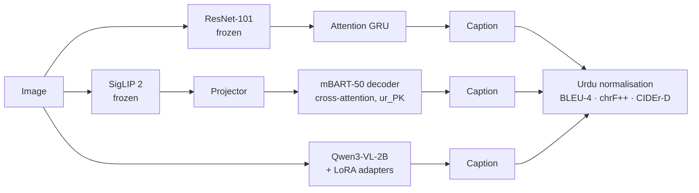

# UrduCap: Image Captioning in Urdu

[](https://github.com/shelenderrkumar/Urdu-Image-Captioning/actions/workflows/ci.yml)


Urdu has more than 230 million speakers, but almost no image-captioning data. UrduCap
builds an Urdu version of Flickr30k (31,783 images, 158,915 machine-translated captions)
and compares three generations of captioning models on it, under one evaluation protocol:

| Model | Idea | Trained parameters |
|---|---|---|
| **CNN + attention GRU** (2024 baseline) | ResNet-101 grid features, Bahdanau attention, word vocabulary learned from scratch | ~10 M |
| **SigLIP 2 + mBART-50** | a modern image encoder joined to a decoder pre-trained to write Urdu, via cross-attention | ~200 M |
| **Qwen3-VL-2B + LoRA** | an open vision-language model, zero-shot and with rank-16 adapters | ~17 M (adapters) |

## Why version 2: the 2024 numbers did not hold up

The 2024 notebooks (kept in [`legacy/`](legacy)) reported a validation BLEU of about **0.74**.
That is higher than human captions score against each other. An audit
([`docs/2024-evaluation-audit.md`](docs/2024-evaluation-audit.md), reproducible with
[`scripts/audit_2024_eval.py`](scripts/audit_2024_eval.py)) found why:

| Problem | Effect | Fix in v2 |
|---|---|---|
| Train/validation split over *captions*, not images | 99.8% of scored images were also training images | image-level Karpathy split (29k / 1k / 1k) |
| `sentence_bleu` given strings, so it counted **characters** | inflated BLEU about 4× (0.568 vs 0.136 for human captions) | corpus BLEU-4 on Urdu word tokens, plus chrF++ and CIDEr-D |
| Random sampling at test time | a different score on every run | greedy or beam search |
| Untranslated English captions kept as targets | noise in training and references | script detection drops them, and reports how many |

## Results

Test split: the 1,000 Karpathy test images, 5 references each. Corpus-level metrics on
normalised Urdu.

| Model | BLEU-4 | chrF++ | CIDEr-D |
|---|---|---|---|
| CNN + attention GRU (2024 architecture, corrected protocol) | *pending* | *pending* | *pending* |
| SigLIP 2 + mBART-50 | *pending* | *pending* | *pending* |
| Qwen3-VL-2B, zero-shot | *pending* | *pending* | *pending* |
| Qwen3-VL-2B + LoRA | *pending* | *pending* | *pending* |

The GPU runs are scripted in
[`notebooks/run_experiments.ipynb`](notebooks/run_experiments.ipynb) (Kaggle or Colab).
This table will be filled with their output, not estimates.

## How it works



- **Urdu text handling** (`urducap/text.py`): different keyboards and translators mix
  look-alike code points, such as Arabic and Urdu yeh, or kaf and keheh. They are unified
  before training and scoring, and diacritics, tatweel and zero-width characters are
  removed. Without this, the same word would count as two different words.
- **One interface for three models** (`urducap/models/`): each model implements `collate`,
  `loss` and `generate`, so one training loop and one evaluator serve all of them.
- **Small checkpoints**: only trained tensors are saved. Frozen backbones are reloaded by
  name, so a run directory holds the projector, decoder layers or LoRA adapters, not
  gigabytes of copied weights.
- **mBART-50 as an Urdu decoder**: the target is decoded from `</s> ur_PK ...`. The
  language code is forced, and the decoder's pre-trained cross-attention reads SigLIP
  patch embeddings instead of text-encoder states.

## Quick start

```bash
pip install -e ".[dev]"
urducap audit --captions captions_30k.json
urducap split --captions captions_30k.json --karpathy dataset_flickr30k.json
urducap train --model encdec --captions captions_30k.json --images flickr30k_images/ --out runs/encdec
urducap evaluate --run runs/encdec --captions captions_30k.json --images flickr30k_images/ --out runs/encdec
urducap caption --run runs/encdec photo.jpg
urducap evaluate --zero-shot vlm --captions captions_30k.json --images flickr30k_images/ --out runs/vlm0
```

Tests run offline on a CPU, with tiny randomly initialised models: `pytest -q`.

## Data

- **Images**: [Flickr30k](https://shannon.cs.illinois.edu/DenotationGraph/) (Young et al., 2014), for non-commercial research use.
- **Urdu captions**: the 158,915 English Flickr30k captions, machine-translated with the
  Google Cloud Translation API (`legacy/translate_with_cloud_api.ipynb`). Translations
  inherit translation errors, which is a limitation of every number above. The roadmap
  includes a human-verified test set.

## Roadmap

- [ ] GPU runs and the results table
- [ ] A human-checked subset of the test references, written by native Urdu speakers, to
      measure how much machine-translated references distort the scores
- [ ] An attention-map and error analysis (counting, gender agreement, colours)
- [ ] An interactive demo

## Repository layout

```
urducap/      package: text, data, metrics, models/{legacy,encdec,vlm}, train, cli
tests/        25 offline tests (tiny models)
scripts/      audit_2024_eval.py
notebooks/    run_experiments.ipynb, every GPU experiment end to end
docs/         2024-evaluation-audit.md
legacy/       the original 2024 TensorFlow notebooks and translation scripts
```

## License

MIT for the code. Flickr30k images and captions keep their original terms.
